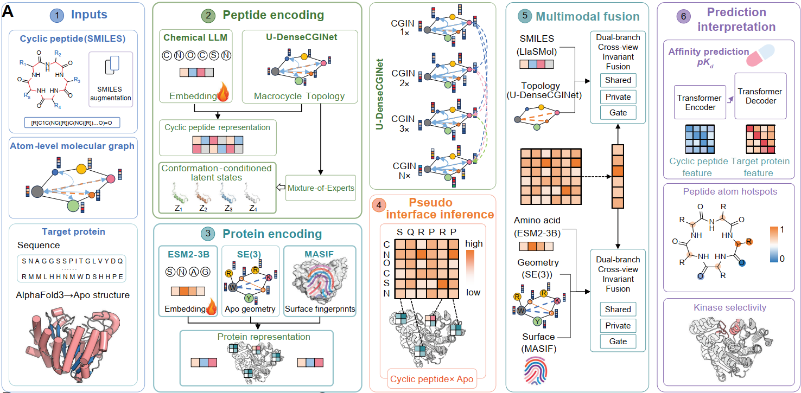

# MALCAT

> A Four-Modal Causal Invariance Learning Framework for Cyclic Peptide–Protein Binding Affinity Prediction


## Project Overview


MALCAT is a multimodal deep-learning project for **regression-based prediction of cyclic peptide–protein binding affinity**. The model jointly uses the following four types of information:

1. **Cyclic peptide SMILES representations**;
2. **Target protein amino acid sequences**;
3. **Target protein three-dimensional structures (CIF)**;
4. **Graph structures constructed from cyclic peptide molecules**.

The project uses locally deployed **LlaSMOL/Mistral-7B** to encode SMILES and **ESM-2 3B** to encode protein sequences. These representations are combined with GraphDenseNet, multiscale graph-based protein 3D feature extraction, and shared/specific feature disentanglement modules to generate a continuous binding-affinity prediction.


---

## Key Features

- **Four-modal joint modeling**: SMILES, protein sequences, protein 3D structures, and molecular graphs.
- **Cyclic peptide-aware molecular graphs**: incorporates peptide bonds, ring systems, functional groups, physicochemical properties, and cyclic positional encodings.
- **Large-model sequence encoding**:
  - LlaSMOL/Mistral-7B for SMILES representation;
  - ESM-2 `esm2_t36_3B_UR50D` for protein-sequence representation.
- **3D structure feature extraction**: based on protein all-atom graphs, spatial adjacency edges, covalent bonds, SE(3)-equivariant layers, MaSIF, and graph-attention modules.
- **Causal invariance learning**:
  - disentanglement of shared and modality-specific features;
  - gradient reversal and adversarial modality learning;
  - conditional cross-modal attention;
  - reconstruction loss and invariance regularization.
- **Training management**: supports best-model saving, checkpoint saving, and resumed training.
- **Regression evaluation metrics**: MSE, Concordance Index, Pearson, Spearman, and \(R_m^2\).

---

## Model Architecture



---

## Project Structure

```text
.
├── data/                          # Raw data and preprocessed PyG data
│   └── peptide/
│       ├── raw/
│       │   ├── data.csv
│       │   ├── data_train.csv
│       │   └── data_test.csv
│       └── processed/
│           ├── processed_data_train.pt
│           └── processed_data_test.pt
├── esm2_t36_3B_UR50D/            # Local ESM-2 model
├── LlaSMOL/
│   ├── Mistral-7B-v0.1/          # Mistral base model
│   └── LlaSMol-Mistral-7B/       # LlaSMOL LoRA adapter
├── log/                           # Training logs and TrainLogger
├── result/                        # Validation metrics and prediction results
├── save/                          # Checkpoints and best models
├── SMILES-enumeration/            # Tools or data related to SMILES enumeration
├── dataset.py                     # Loader for processed PyG datasets
├── mestic.py                      # Regression evaluation metrics
├── model.py                       # MALCAT model and functional modules
├── predict.py                     # Model inference script
├── processpeptide.py              # Cyclic peptide preprocessing and molecular graph construction
├── se3andmaif.py                  # Protein 3D structure feature extraction
├── train_model.py                 # Model training and checkpoint resumption
└── untils.py                      # Utilities for averaging, best-value tracking, and model saving
```

---

## Environment Requirements

Linux, a CUDA-enabled GPU, and a Conda environment are recommended. Because the project loads both Mistral-7B and ESM-2 3B, training generally requires a GPU with substantial memory.

### 1. Create the Environment

```bash
conda create -n malcat python=3.10 -y
conda activate malcat
```

### 2. Install PyTorch

Install a PyTorch version compatible with your local CUDA version. After installation, verify the environment:

```bash
python -c "import torch; print(torch.__version__); print(torch.cuda.is_available())"
```

### 3. Install Additional Dependencies

```bash
pip install -r requirements.txt
```

Installing RDKit through Conda is recommended:

```bash
conda install -c conda-forge rdkit -y
```

Major dependencies include:

- PyTorch
- PyTorch Geometric
- Transformers
- PEFT
- Accelerate
- RDKit
- Biopython
- SciPy
- scikit-learn
- pandas
- NumPy
- NetworkX
- Matplotlib
- tqdm

---

## Preparing the Pretrained Models

`model.py` uses `local_files_only=True`, so models are not downloaded automatically at runtime. Place the model weights in the following locations:

```text
LlaSMOL/
├── Mistral-7B-v0.1/
└── LlaSMol-Mistral-7B/

esm2_t36_3B_UR50D/
```

The default paths are resolved relative to the directory containing `model.py`:

```python
LlaSMOL/Mistral-7B-v0.1
LlaSMOL/LlaSMol-Mistral-7B
esm2_t36_3B_UR50D
```

If the models are stored elsewhere, provide absolute paths when initializing `SimpleSequenceExtractor`.

> esm2_t36_3B_UR50D https://huggingface.co/facebook/esm2_t36_3B_UR50D
> LlaSMol-Mistral-7B: https://huggingface.co/osunlp/LlaSMol-Mistral-7BLlaSMol-Mistral-7B is an LLM for chemistry. It is based on mistralai/Mistral-7B-v0.1 https://huggingface.co/mistralai/Mistral-7B-v0.1 and tuned on our SMolInstruct dataset with LoRA. This repo contains the weight of the low-rank adapter. 
> 

---

## Data Format

Raw data should be placed by default at:

```text
data/peptide/raw/data.csv
```

The CSV file should contain at least the following fields:

| Field | Required | Description |
|---|---:|---|
| `compound_iso_smiles` | Yes | Canonical SMILES of a cyclic peptide or candidate molecule |
| `target_sequence` | Yes | Amino acid sequence of the target protein |
| `affinity` | Yes | Continuous binding-affinity label |
| `protein_3d_path` | No | Path to the corresponding protein CIF/mmCIF file |
| `class` | No | Used for stratified splitting during preprocessing, if available |

Example:

```csv
compound_iso_smiles,target_sequence,affinity,protein_3d_path
"C1CCNC(=O)CNC(=O)C1","MKTLLLTLVVVTIVCLDLGYT...",7.42,"data/structures/target_001.cif"
```

### Data Processing Rules

- Maximum protein-sequence length: `1200`;
- Maximum SMILES character-sequence length: `150`;
- Maximum LlaSMOL tokenizer length: `128`;
- Maximum ESM-2 tokenizer length: `512`;
- If only `data.csv` is provided, the preprocessing script automatically generates an `8:2` split:
  - `data_train.csv`
  - `data_test.csv`
- If a `class` field is present, stratified splitting is used;
- The random split seed is `42`;
- If `protein_3d_path` is missing or the corresponding file does not exist, the 3D structure branch uses a zero vector.

---

## Data Preprocessing

Place the raw dataset at:

```text
data/peptide/raw/data.csv
```

Then run:
Data segmentation
```bash
python split.py
```
Data augmentation
```bash
python SMILES-enumeration/SmilesEnumerator.py
```
Data preprocessing
```bash
python processpeptide.py
```

The script performs the following steps:

1. Reads and splits the training and test sets;
2. Parses SMILES using RDKit;
3. Constructs directed molecular graphs;
4. Extracts atom, bond, ring-system, peptide-bond, functional-group, and physicochemical features;
5. Adds cyclic peptide backbone positional encodings and ring-closure edges;
6. Generates PyTorch Geometric data objects;
7. Saves the following files:

```text
data/peptide/processed/processed_data_train.pt
data/peptide/processed/processed_data_test.pt
```

The current entry point in `processpeptide.py` is fixed as:

```python
GNNDataset("data/peptide")
```

To use a different dataset name, modify this path or refactor it into a command-line argument.

---

## Model Training


### Start Training

```bash
python train_model.py \
  --dataset peptide \
  --save_model \
  --lr 0.0001
```

Available arguments:

| Argument | Default | Description |
|---|---:|---|
| `--dataset` | Required | Name of the dataset directory under `data/` |
| `--save_model` | Disabled | Whether to save the best model and checkpoints |
| `--lr` | `0.0001` | Adam learning rate |
| `--batch_size` | `1024` | Command-line value; the current DataLoader remains fixed at `128` |

Current training configuration:

```text
Optimizer: Adam
Loss: MSELoss
Epochs: 600
Steps per epoch: 50
Scheduler: StepLR(step_size=10, gamma=0.1)
```

Saved outputs include:

```text
save/<run_name>/model/best_model.pth
save/<run_name>/model/checkpoint.pth
result/test_result_BS1024_<dataset>.csv
```

Each checkpoint contains:

- model parameters;
- optimizer state;
- learning-rate scheduler state;
- current epoch;
- global step;
- best validation loss.

---

## Prediction

By default, the prediction script reads:

```text
data/<dataset>/processed/processed_data_test.pt
```

Example:

```bash
python predict.py \
  --dataset peptide \
  --model_path save/<run_name>/model/best_model.pth \
  --data_root data \
  --output result/predictions.csv \
  --batch_size 1
```

Example output:

```csv
prediction
7.3812
6.9547
```

If the PyG data object contains an `id` field, the prediction script also adds an `id` column to the output.

---


## Evaluation Metrics

`mestic.py` provides the following metrics:

| Metric | Description |
|---|---|
| MSE | Mean squared error and the base loss used by the training script |
| CI | Concordance Index, which measures consistency in prediction ranking |
| Pearson | Pearson linear correlation coefficient |
| Spearman | Spearman rank correlation coefficient |
| \(R^2\) | Coefficient-of-determination-related calculation |
| \(R_m^2\) | Regression evaluation metric combining \(R^2\) and \(R_0^2\) |

---

## Acknowledgments

This project uses or depends on the following open-source ecosystems and pretrained models:

- PyTorch
- PyTorch Geometric
- Hugging Face Transformers
- PEFT
- RDKit
- Biopython
- ESM-2
- LlaSMOL / Mistral

For academic use, please cite the original publications and repositories according to the requirements of each project.

---

## License

No open-source license has currently been declared for this repository. Until a formal license is added, all rights are reserved. Please contact the repository author before using, modifying, or distributing the code.

---

## Contact

To report issues, discuss reproducibility, or propose improvements, please contact the repository author through GitHub Issues.
